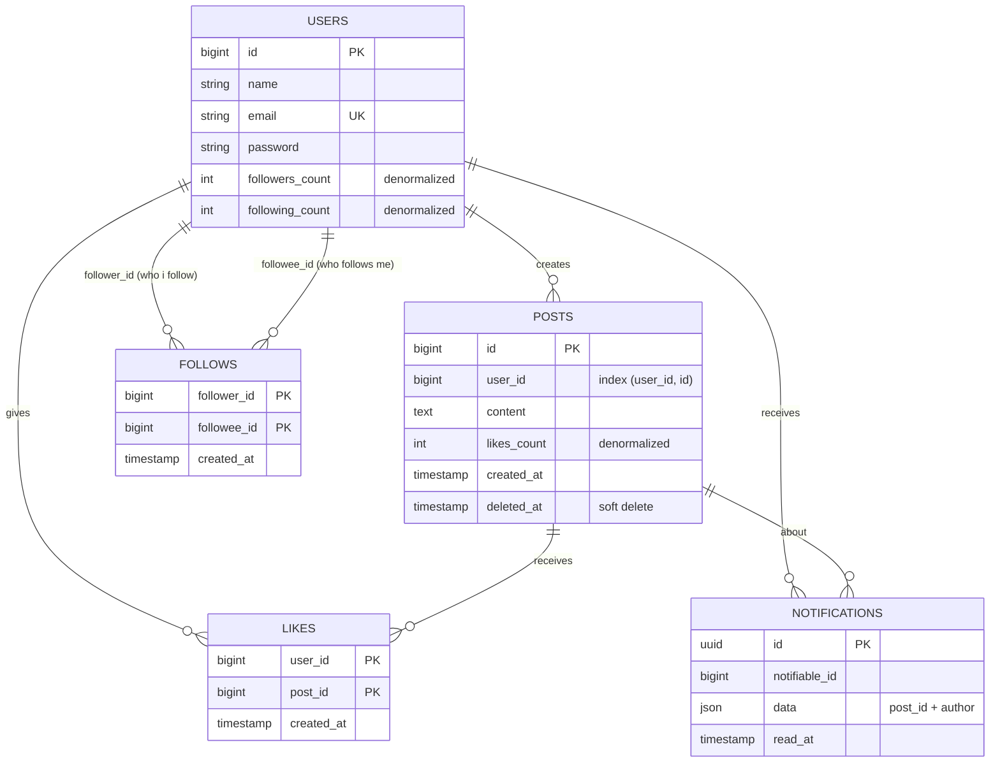
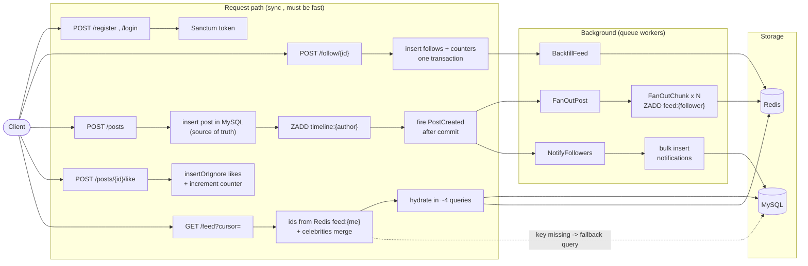
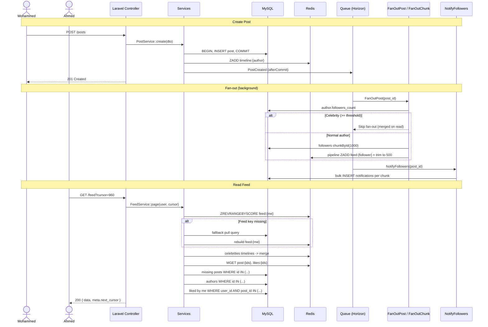

# Architecture Document
#### This file was written by Human then restyled with AI.

### System Design

Before writing any text , i'll go with Mermaid for the entities and the flow due to few reasons:
- GitHub renders Mermaid directly inside the README , so the reviewer sees the diagram without opening any external tool or image.
- It's text , so it lives in the repo with the code and changes in the same PR when the schema changes. An image exported from draw.io gets outdated from the first migration change and no one updates it.
- It's reviewable , any change in the diagram shows up in the git diff like any code.
- One diagram of the relations explains the task faster than a paragraph for every table.

The only downside is that Mermaid doesn't give me full control over the layout , and for this task that's totally fine.

##### Core entities



What to notice in the diagram:
- **users** the fields from the task (id, name, email, password) + two counters `followers_count` and `following_count`. Why they are here and not counted on the fly is explained in the trade-offs (the fan-out job needs to know "is he a celebrity ?" in O(1)). Auth is Sanctum tokens , the task is API only so no need for Breeze/Fortify.
- **follows** has no `id` column , the primary key is the pair (follower_id, followee_id). The pair itself is the identity of the row , and the PK prevents following the same user twice from the DB level.
- **posts** the fields from the task (id, user_id, content, created_at) + `likes_count` and `deleted_at`.
- **likes** same idea as follows , the PK is (user_id, post_id) so double like is impossible.
- **notifications** Laravel's default notifications table , filled by the queue workers not by the request.

##### Flow



And in words:
- Register / Login -> Sanctum issue token -> every other endpoint is behind `auth:sanctum`.
- Follow -> insert into follows + increment both counters in one transaction -> dispatch a small job to backfill the latest posts of that user into my feed.
- Create post -> validate -> persist in MySQL first (source of truth) -> add the post id to the author timeline in Redis -> fire `PostCreated` after commit -> return 201 immediately.
- Queue workers -> fan-out the post id into the followers feeds in Redis + send notifications to followers , in the background and in chunks.
- Read feed -> post ids from the Redis sorted set -> hydrate posts, authors, likes in a fixed number of queries -> return with a cursor for the next page.
- Like -> insert ignore into likes -> if it's really inserted increment the counter in DB and Redis.

The main idea the diagram shows: **everything heavy is in the Background box , the Request box only touches one row or one Redis key.**

### Architecture Challenges
Or what I notice from the task file

- Feed generation  the naive query (join follows with posts and order by created_at) works fine with 100 users, but with 5M users and 500k posts per day it'll be the slowest query in the system and it's the most called endpoint.
- Celebrity problem  a user with 2M followers creating one post means 2M writes if i push the post to every follower. That can block the queue for everyone else.
- N+1  the feed returns posts + author + likes count + did i like it, if i do it inside the loop that's 60 queries for a page of 20 posts.
- Counting likes  COUNT(*) on the likes table for every post in every feed request is a killer on a viral post.
- Pagination  new posts are arriving all the time while the user is scrolling, offset pagination will give him duplicates or skip posts.
- Notifications  sending notification to thousands of followers can't be inside the request, and can't be one huge job either.
- Caching  what exactly to cache ? the feed response changes with every new post and every like so caching it as it is may give me near zero hit rate.
- Consistency  if the post is deleted or i unfollowed someone , what happens to the feeds that already have this post ?

### Numbers first (Performance Challenge)
Before taking any decision i did some math (back-of-the-envelope estimation) , cause every decision below depends on it. "Is the feed query slow ?" has no answer until i know how many times per second it runs.

To be honest about where the numbers come from , there are two types here:
- **Given by the task** : 5M users and 500k posts per day. These are facts for me.
- **My assumptions** : everything else. The task doesn't say how active the users are or how many followers they have , so i picked common rule-of-thumb values used in system design estimations and i'll explain every one. They are not measured , and the point is not to be exact , the point is the **order of magnitude** (hundreds per second or hundreds of thousands per second ? that changes the whole design).

#### Where every number comes from

**1. Posts per second (from the task)**
One day = 24 x 60 x 60 = 86,400 seconds ≈ ~100k (i round it to make the math easy).
500,000 / 86,400 ≈ **~6 posts per second** average.

**2. Peak factor x10 (assumption)**
The traffic is never flat across the day , people use social apps in the evening and around events (a match , breaking news) and almost nothing at 4am. So the average lies , the system must survive the peak. A common assumption is peak = 2x to 10x of the average , and i take the worst case x10 to be on the safe side.
6 x 10 = **~60 posts per second on peak**.

**3. Average followers ~200 (assumption)**
The important word is *average* not *typical*. Most users have a few dozen followers , and few users have millions , so the average gets pulled up by the big accounts. ~200 is a common value used in feed design estimations. And the fan-out cost is exactly: posts x followers.
500k posts x 200 = **~100M feed inserts per day** , / 86,400 ≈ **~1.2k Redis writes per second** average (~12k on peak).
This number is the reason the fan-out must be in the queue and not in the request.

**4. Daily active users 20% (assumption)**
Not all the 5M users open the app every day. The ratio of daily active / total users for social apps is usually somewhere between 20% and 50% , i took the lower side.
5M x 20% = **1M active users per day**.
Why the lower side ? cause it's also used for the Redis memory (only active users have a feed in memory) , and if the real ratio is higher it's easy to scale Redis , the design doesn't change.

**5. Feed loads 20 per user per day (assumption)**
Open the app few times a day , and every scroll that reaches the end loads the next page. 20 page loads per day per active user is a reasonable number.
1M x 20 = **20M feed requests per day** , / 86,400 ≈ **~230 per second** average , x10 peak = **~2-3k per second**.

**6. Posts table growth (from the task)**
500k x 365 = **~180M rows per year**. This is why every query on posts must use an index , a full table scan on 180M rows is not an option.

| Metric | Source | Math | Result |
|---|---|---|---|
| Posts/sec | Task | 500k / 86,400 | ~6 avg , ~60 peak |
| Feed inserts (fan-out) | Assumption: 200 avg followers | 500k x 200 | ~100M/day , ~1.2k/sec |
| Daily active users | Assumption: 20% | 5M x 20% | 1M |
| Feed reads | Assumption: 20 loads/day | 1M x 20 | ~20M/day , ~230/sec , 2-3k/sec peak |
| Posts rows | Task | 500k x 365 | ~180M/year |
| Redis memory for feeds | 1M feeds x 500 ids x ~60 bytes | | ~30GB |

**What these numbers tell me:**
- The feed reads (~230/sec) are ~40x more than the post writes (~6/sec) , so any work i can move from the read time to the write time , i'll do it. This one line is the reason of the hybrid fan-out decision.
- The fan-out writes (~1.2k/sec) are fine for Redis (it handles way more than that per second) but they are too much to be done inside the HTTP request.
- 180M rows per year means every query must hit an index , and that's the Query Busters section below.
- If any assumption is wrong by 2x or 3x , the design is still the same. If it's wrong by 100x , the scaling section says what's next (read replicas , partitioning , Redis Cluster).

### Trade-offs and decisions

At this section 'll list the challenges that i faced and the decisions I made to overcome them.

#### 1. Feed generation:

This is the most important decision in the task, so let's list the options,
and to make it simple , Ahmed follows Mohammed and 300 other users, Mohammed creates a post, how Ahmed will see it ?

**1.1 Option (A)** - Fan-out on read (Pull): When Ahmed opens the feed, we go and query the posts of all the 300 users he follows, sort them by newest and return 20.

```sql
SELECT * FROM posts
WHERE user_id IN (SELECT followee_id FROM follows WHERE follower_id = ?)
ORDER BY id DESC LIMIT 20;
```

The write is free , Mohammed's post is just one insert.

**Its problem**: every feed request pays the cost of the whole follow graph. If Ahmed follows 2000 users the database needs to merge 2000 index ranges just to give him 20 posts, and multiply that with 3k requests per second on peak. The read is the hot path so this is the wrong place to pay.

**1.2 Option (B)** - Fan-out on write (Push): When Mohammed creates the post, a queued job pushes the post id into the feed of every follower (a Redis sorted set per user). When Ahmed opens the feed it's just "give me the top 20 ids" from his own list, it's already sorted and ready.

The read is O(page size) , doesn't matter how many users he follows.

**Its problem**: The Celebrity problem. If Mohammed is a celebrity with 2M followers, one post = 2M Redis writes. The queue will be busy with one post and all the other normal users posts will wait behind it , so the feed will be late for everyone.

**1.3 Option (C)** - Hybrid: Push for normal users, Pull for celebrities.
- If the author followers_count < threshold (10k by default and it's configurable) -> fan-out on write like option (B).
- If the author is a celebrity -> no fan-out at all. When Ahmed opens the feed we take his ids from Redis + the latest posts of the celebrities he follows (each celebrity has his own timeline cached in Redis) and merge them together. The number of celebrities that one user follows is small so the merge is cheap.

I'll go with option (C) , it's the same idea Twitter described publicly for their timeline, and it's the only one that works with both of the cases in the numbers above. The trade-off i accept here is:
- The read path is more complex (there is a merge step).
- The feed is eventually consistent , Ahmed will see the post after few seconds not in the same millisecond. For a social feed that's totally fine.

And one more important thing , **Redis is a cache not the source of truth**. If the feed key is missing (user was inactive, key expired, Redis restarted) we fall back to option (A) query from MySQL and rebuild it. So option (A) is still there but only as a fallback not in the hot path.

How the feed looks in Redis:
```
feed:{user_id}      ZSET  member = post_id , score = post_id , capped at 500
timeline:{user_id}  ZSET  the author own posts (used for celebrities + follow backfill)
```
- score is the post id not the timestamp , the ids are auto increment so the order is the same as created_at and there is no two posts with the same score.
- capped at 500 posts , no one scroll deeper than that , and if he does we go to the DB fallback.
- TTL 7 days and it's refreshed on every read , so only active users have feeds in memory. ~1M active feeds x 500 x ~60 bytes ≈ 30GB , in production that'll be Redis Cluster.

#### 2. Pagination:

**2.1 Option (A)** - Offset pagination (`?page=5`): the default `paginate()` in Laravel.

**Its problem**: two problems actually. First, `OFFSET 10000` means the DB reads 10000 rows and throws them away , it gets slower the deeper you scroll. Second , while Ahmed is on page 1 , 5 new posts are created , when he goes to page 2 he will see 5 posts again that he already saw in page 1.

**2.2 Option (B)** - Cursor pagination (`?cursor=960`): the client sends the id of the last post he saw, and we return the posts with id < cursor.

It's an index seek every time no matter how deep, and new posts don't shift anything.
The only thing i lose is "jump to page 50" and no feed in the world needs that.

I'll go with option (B), and the response returns `next_cursor` and `has_more` in the meta.

#### 3. Likes count and "did i like it":

The task says the API should return total likes and whether the user liked the post, so for every post in the feed i need these two values.

**3.1 Option (A)** - `withCount('likes')` / COUNT(*) on read: simple and always correct.

**Its problem**: a viral post with 1M likes , every feed request that contains it will count 1M rows. And the feed is the most called endpoint.

**3.2 Option (B)** - Denormalized counter column `likes_count` on posts: on like we do `UPDATE posts SET likes_count = likes_count + 1` (atomic, no race condition cause the DB does the increment not PHP) and cache it in Redis `likes:{post_id}`.

Reading it is free, it's already on the row.

**3.3 Option (C)** - Redis only counter + scheduled job that flushes the counters to MySQL every few seconds: this is the best for a viral post cause 1000 likes per second on the same row will make row lock contention on MySQL.

I'll go with option (B) for this task, and i'll leave option (C) documented as the upgrade path when a hot post appears. Starting with (C) now is over engineering for the task , but i know where it goes.

For the likes itself:
- `likes` table primary key is (user_id, post_id) so double like is impossible from the DB itself.
- `INSERT IGNORE` (insertOrIgnore in Laravel) , and i only increment the counter if a row was really inserted. So double tap from the mobile app doesn't count twice. Same for unlike , unlike on a post i didn't like is just 204 no-op.
- "did i like it" is **one** query for the whole page: `SELECT post_id FROM likes WHERE user_id = ? AND post_id IN (...)` and it's served by the primary key directly.

#### 4. Avoiding N+1 and heavy joins:

The easy way is `Post::with('user')->withCount('likes')` and that's already fine for N+1 , but it's still a join on the follows table + a count. Since i'm taking the ids from Redis i don't need the join at all.

So the feed request is always:
```
1. ids      ZREVRANGEBYSCORE feed:{me} from cursor limit 20 (+ celebrities merge)
2. posts    from Redis cache post:{id} , the missing ones: WHERE id IN (...)
3. authors  one query WHERE id IN (distinct user ids) , also cached
4. liked?   one query on likes WHERE user_id = me AND post_id IN (...)
5. counts   from Redis likes:{post_id} or the likes_count column
```
~4 queries per page , doesn't matter if the page has 20 posts from 20 different authors , and zero join between follows and posts.
And i'm not saying that only , there is a test that counts the queries of the feed endpoint and fails if it's more than 4 (see testing section).

#### 5. Queue system (notifications + fan-out):

The task says send notifications to followers using Laravel Queue , so the question is how to design it not if.

**5.1 Option (A)** - One job per post that loops on all followers and sends the notification with `Notification::send()`.

**Its problem**: a user with 9k followers , one job doing 9k inserts. If it fails in the middle (timeout at follower 7000) the retry starts from zero so the first 7000 get duplicated notifications. And `Notification::send()` is one query per user.

**5.2 Option (B)** - One job that splits the followers into chunks, and each chunk is its own job:

```
PostCreated (event , dispatched after commit)
   └─ FanOutPost  [queue: feed]
        ├─ celebrity ? -> stop (the read merge handles it)
        └─ followers chunkById(1000)
             └─ Bus::batch( FanOutChunk x N )  -> Redis pipeline ZADD for 1000 followers in one round trip

   └─ NotifyFollowers  [queue: notifications]
        └─ SendNotificationChunk x N  -> one bulk INSERT per 1000 followers
```

I'll go with option (B) and here is the why for every piece:
- **Two different queues** `feed` and `notifications` with separate Horizon supervisors , so if notifications are late for any reason , the feed is not affected. The feed queue have more workers.
- **Chunks** , each chunk retries alone , a failed chunk doesn't repeat the whole thing.
- **Bulk insert** , 1 query per 1000 users instead of 1000 queries.
- **Idempotent jobs** , ZADD is idempotent by nature (adding the same id twice does nothing), and notifications have unique (post_id, user_id) so the retry is safe.
- **afterCommit** , the worker never takes a post that the transaction rolled back.
- `tries = 3` + exponential backoff + failed_jobs table + Horizon for monitoring.
- For celebrities the notifications are still sent but in low priority , in the real world it's only for the users who turned on "post notifications" , i'm mentioning that as a trade-off not implementing it.

Why Redis for the queue and not the database driver ? cause the database driver is polling the same MySQL that i'm trying to protect in all this document.

#### 6. Caching:

The task says cache feed responses and like counts, and here i've to decide what exactly is the "feed response".

**6.1 Option (A)** - Cache the whole JSON response per user (`Cache::remember("feed:{$user}:page:1")`).

**Its problem**: the response is invalidated by every new post from anyone i follow and by every like on any post on the page. So the hit rate will be close to zero and the same post is duplicated in the cache of every follower.

**6.2 Option (B)** - Split it: the list of ids per user + the post data shared for all users.

| Key | Type | TTL | Invalidation |
|---|---|---|---|
| `feed:{user}` | ZSET of post ids | 7 days sliding | append only , capped , rebuilt on miss |
| `timeline:{user}` | ZSET | 7 days | add on create, remove on delete |
| `post:{id}` | hash | 24h | deleted on post delete |
| `user:{id}:card` | hash (id, name) | 24h | on profile update |
| `likes:{post}` | counter | no TTL | INCR/DECR on like , loaded from DB on miss |
| `celebs:{user}` | set of celebrities i follow | 1h | on follow/unfollow |

One cached post serves all of its followers , that's the whole point.

I'll go with option (B).
And for sure "did i like it" is **never** cached , it's per user, it's one cheap query on the primary key, and it must be correct right after the user clicks like. Same rule for anything the user just changed and expects to see.

Why Redis and not Memcached ? cause Memcached is key/value only , the feed needs sorted sets and there is no way to do it there.

#### 7. Delete post and unfollow:

**7.1 Option (A)** - Eager: on delete, remove the post id from every follower feed. On unfollow , remove all his posts from my feed immediately.

**Its problem**: deleting a post of a user with 500k followers = 500k Redis writes for a post that most of them will never scroll to.

**7.2 Option (B)** - Lazy: soft delete the post and bust its cache , and that's it. When the feed is hydrated the deleted ids are just skipped (i fetch limit + 5 ids so the page is still full), and they leave the feed by themselves because of the 500 cap. On unfollow a background job removes his posts from my feed.

I'll go with option (B), the trade-off is that the page may return 19 posts instead of 20 in a rare case, or i may see one post from someone i just unfollowed for few seconds. That's acceptable.

And on follow , a small job backfills the latest ~20 posts of that user into my feed from his timeline , otherwise i follow someone and nothing changes until he posts again.

#### 8. Database indexes:

```sql
follows  PRIMARY KEY (follower_id, followee_id)   -- who do i follow + prevent duplicates
         INDEX (followee_id, follower_id)          -- who follows me , used by the fan-out , covering index
posts    INDEX (user_id, id)                       -- author timeline + the fallback query + cursor
likes    PRIMARY KEY (user_id, post_id)            -- prevent double like + "did i like these posts"
         INDEX (post_id)                           -- cleanup on post delete
users    UNIQUE (email)
```

Decisions here:
- **Composite primary keys** on follows and likes without auto increment id , the row is identified by the pair anyway, so the primary key is the index i need and i save one index.
- **(user_id, id) not (user_id, created_at)** , id is unique and ordered so the cursor is clean without a tie breaker column.
- **followers_count on users** , the fan-out job needs to know "is this a celebrity ?" in O(1) not by counting 2M rows.
- **No foreign keys in production** , may you ask why , FKs add check/lock cost on the hottest tables and they block sharding later. I keep them in the migration for local dev and the integrity is enforced in the service layer. It's a conscious trade-off not a mistake.

When one MySQL is not enough: read replicas first (Laravel read/write connections with `sticky` so the user sees his own writes) , then partition posts and likes by user_id , then move old posts to cold storage.

#### 9. Testing:

The reviewer will need to see a test suite with deterministic results in /tests, and for this task the most important thing to prove is the feed , not the happy path of register.

I'll use Pest with feature tests , and the ones that really matter:
- Feed returns only posts from users i follow, newest first.
- Cursor stability: create posts in the middle of scrolling and make sure page 2 has no duplicates.
- Deleted posts are skipped from the feed.
- Like twice = count 1 , unlike without like = no error.
- Can't follow myself (422) , can't delete other user post (403).
- **Query count test**: enable the query log , hit `/feed` with 20 posts from 20 different authors and assert ≤ 4 queries. This is how i prove there is no N+1 instead of just saying it.

For the queue: `Bus::fake()` / `Queue::fake()` and assert that a normal author dispatches the chunk batch and a celebrity author dispatches no fan-out at all.

For the feed logic itself: the Redis part is behind a `FeedStore` interface , so in unit tests i bind an in-memory implementation and test the merge logic (normal feed + celebrities) without Redis running.

And a seeder with factories ~10k users, some celebrities and ~200k posts , to show the `EXPLAIN` of the fallback query in the README.

### Design Patterns worth to use [ With AI Re-styling ]
Bottom line: the task explicitly asks for "service or repository pattern" , so here it's not cargo-culting , but i'll still only use them where they solve something.

**Service Layer** : `FeedService`, `PostService`, `LikeService`, `FollowService`. All the business rules, transactions and events live here. The controllers are thin: request -> service -> resource, no queries in the controller.

**Repository pattern (only where the storage is non-trivial)** : the real value here is `FeedStore` interface , Redis implementation in production, array implementation in tests. Same for `CounterStore`. For Eloquent i have `PostRepository`, `FollowRepository`, `LikeRepository` for the queries that are specific (fallback feed query, liked-by-me query , bulk followers chunk). I'm not wrapping `User::find()` in a repository just for ceremony.

**Command/Job as first-class objects** : `FanOutPost`, `FanOutChunk`, `NotifyFollowers`, `BackfillFeed`, `PruneFeedOnUnfollow`. Laravel's queued jobs *are* the Command pattern.

**Observer/Event-driven** : `PostCreated` event with listeners for the fan-out and the notifications. Creating a post doesn't know anything about feeds or notifications , and adding a new listener later (search indexing for example) doesn't touch the post creation code.

**DTOs** : `CreatePostData`, `FeedPage` (readonly classes) between the validation and the service , and the Redis shape doesn't leak to the controllers.

**Form Requests + API Resources + Policies** : validation in `StorePostRequest`, response shape in `PostResource`, "only the owner can delete" in `PostPolicy`.

**One error format** : all exceptions (404, 403, 422, 429, 500) return the same JSON envelope from `bootstrap/app.php`:
```json
{ "message": "Post not found", "code": "POST_NOT_FOUND", "errors": {} }
```

## Skip these : commonly reached for, not worth it here

- **Repository for every model** : explained above , only where there is a reason.
- **Microservices / separate feed service** : the task is one Laravel app , i mention it in the scaling section as the next step not as code.
- **CQRS / event sourcing** : wrong scale for the task , the Redis feed is already a read model and that's enough.
- **Kafka** : Redis queue + Horizon covers the numbers above , Kafka is for when the fan-out itself needs to be a separate system.

## How this maps to what's actually graded

| Task requirement | What answers it |
|---|---|
| Feed API , latest from followed users , newest first | Hybrid fan-out + Redis sorted sets + DB fallback |
| Pagination | Cursor on post id |
| Avoid N+1 | Fixed ~4 queries hydration + query count test |
| Likes total + liked by me | Denormalized counter + one IN query on the primary key |
| 5M users / 500k posts per day | The numbers table + hybrid + cap + TTL + replicas/partitioning |
| Indexes / avoid heavy joins | Composite keys , (user_id, id) , no follows⋈posts join in the hot path |
| Queue notifications | Chunked batches , two queues , bulk insert , idempotent jobs |
| Caching feed + like counts | ids per user + shared entity cache + Redis counters |
| Code quality | Thin controllers , services , repositories where needed , FormRequests , Policies , one error format |
| Bonus | Docker , Pest tests , Scribe docs , feed caching strategy |

### Mermaid Explanation

### DFD (Data Flow Diagram) - Showoff
#### Just to give a visual representation of the system's architecture and data flow, here's a Mermaid diagram that illustrates the create post , fan-out and read feed flows:



Notes :
- The request of create post ends before any follower feed is touched , the fan-out is fully in the background.
- The celebrity branch is deliberate , it's the whole reason of the hybrid decision.
- If Redis is gone completely , the feed still works from MySQL , slower but correct.

### API Surface
The endpoints from the task + one missing endpoint:

| Method | Endpoint | Notes |
|---|---|---|
| POST | /register | 201 + token |
| POST | /login | token , throttled |
| POST | /follow/{user_id} | 204 , idempotent , 422 on self follow |
| DELETE | /follow/{user_id} | 204 , idempotent |
| POST | /posts | 201 , content 1-1000 chars |
| GET | /posts/{id} | with likes_count , liked_by_me , author |
| DELETE | /posts/{id} | 204 , owner only (403) |
| POST | /posts/{id}/like | 204 , idempotent |
| DELETE | /posts/{id}/like | 204 , idempotent |
| **GET** | **/feed?cursor=&limit=** | **not in the endpoints table of the task but section 3 needs it , so i added it** , limit max 50 |

### Setup and deployment
Docker compose: app (php-fpm), nginx, mysql, redis, horizon, scheduler. I prefer an explicit compose file over Sail here cause it's closer to production and clearer for the reviewer. `make up && make seed` and it's running.
Queue: Redis + Horizon , not the sync driver , otherwise the "async" story is fake.
API docs: Scribe on `/docs` , it reads the FormRequests and routes directly.
Build order: I'll build the DB fallback feed first (correct) then the Redis fan-out on top of it (fast) , so the first one is the baseline that i test the second against.
README: setup instructions + the trade-offs from this file + the scaling section , that's what the submission asks for.

### Stack as task
Backend Framework: Laravel 12 (PHP 8.3)
Auth: Sanctum
Database : MySQL 8
Cache / Feed store / Queue : Redis + Horizon
Tests : Pest
Docs : Scribe
